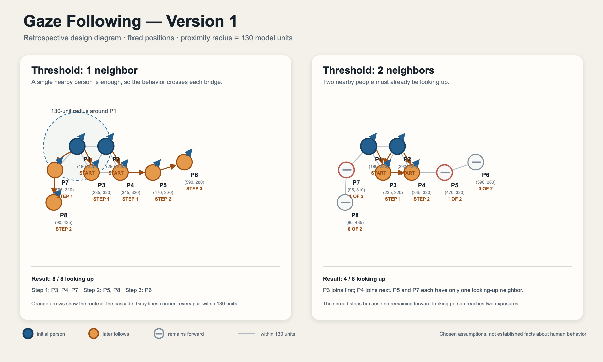

# Gaze Following — Version 1

Gaze Following is a small interactive webpage that represents how looking-up behavior might spread through a group. It was created for the course assignment **“Represent a Phenomenon with Code and AI.”**

This is a simplified computational model, not a scientific prediction of human behavior.

## Model rules

- Eight people (P1–P8) remain at fixed positions.
- Each person is either looking forward or looking up.
- P1 and P2 are the predefined starters.
- Two people count as neighbors when the distance between their positions is no more than 130 model units.
- At each step, a forward-looking person counts nearby people who are already looking up.
- A person looks up when that count reaches the selected threshold: 1 neighbor or 2 neighbors.
- Everyone marked during a step changes simultaneously, so a new response cannot influence another person until the next step.
- The simulation stops when no more people change.

With the supplied positions, threshold 1 ends with 8/8 people looking up, while threshold 2 ends with 4/8.

## Run locally

No external libraries or build step are required. Because the JavaScript uses browser modules, serve the `dist` directory with a small local server:

```bash
python3 -m http.server 8000 --directory dist
```

Then open <http://localhost:8000>.

## Source files

- `dist/index.html` — page structure, controls, model explanation, and accessibility text.
- `dist/styles.css` — layout, figure styling, responsive design, and gaze-state animation.
- `dist/model.mjs` — positions, proximity radius, starter identities, distance calculation, and simultaneous update rule.
- `dist/app.js` — renders the people, handles Start and Reset, advances timed steps, and updates the counter.
- `tests/model.test.mjs` — checks the model outcomes and simultaneous-update behavior.
- `tests/browser-check.mjs` — checks the main interactions in a browser.

## Retrospective design diagram



The diagram documents the completed Version 1 model. It is retrospective rather than a sketch produced before development.
